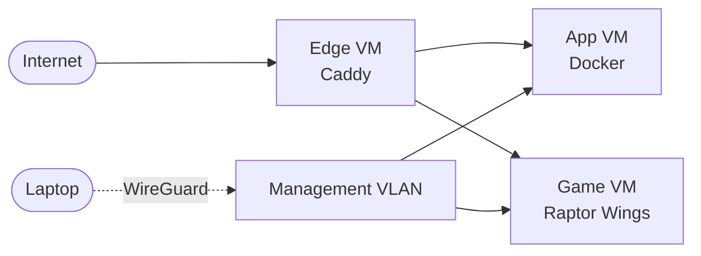

import Callout from "../../components/mdx/Callout.astro";
import Decision from "../../components/mdx/Decision.astro";
import Figure from "../../components/mdx/Figure.astro";

<Callout type="note" title="This page is a draft">
It has `draft: true`, so it shows up in `pnpm dev` and is left out of the live site. Everything below is example content to overwrite.
</Callout>

Open with two or three sentences a stranger can follow: what this is, who it is for, and what state it is in. Someone who stops reading here should still know what you built.

## The problem

What was wrong or missing before. Be specific: what broke, what it cost you, what you could not do. A reader who has had the same problem should recognise it.

## Constraints

What you had to work within. Budget, hardware you already owned, power, noise, a single public IP, things that could not have downtime.

- One mini PC, 32 GB of RAM, no rack
- A residential connection with no static IP
- Nothing exposed to the internet that doesn't have to be

## Architecture

Draw it. A fenced `mermaid` block becomes a diagram:



Then walk through it in words. Name each box, say what talks to what, and say why the boundaries are where they are.

For a diagram made elsewhere, export it as an SVG or PNG, put it next to this file, and wrap it in a figure:

<Figure caption="Captions say what the reader should notice, not what the image is.">
  <svg viewBox="0 0 640 120" role="img" aria-label="Three boxes in a row joined by arrows">
    <g fill="none" stroke="currentColor" stroke-width="1.5">
      <rect x="20" y="30" width="160" height="60" rx="8" />
      <rect x="240" y="30" width="160" height="60" rx="8" />
      <rect x="460" y="30" width="160" height="60" rx="8" />
      <path d="M180 60h60M400 60h60" />
    </g>
  </svg>
</Figure>

## Decisions

This is the part a repo can't show. For each choice that mattered, say what you picked, what you ruled out, and why.

<Decision
  question="Where does TLS terminate?"
  chose="One Caddy instance on the edge VM"
  rejected={["A proxy on every VM", "A tunnel service in front of everything"]}
>
One place to renew certificates and one place to read access logs. A proxy per VM would mean keeping several configs in step, and a tunnel service would put a third party in the path of every request.
</Decision>

Config and commands go in code blocks, with the language named so they are highlighted:

```yaml
services:
  app:
    image: ghcr.io/example/app:1.4.2
    restart: unless-stopped
    networks: [internal]
```

## What happened

The result, with numbers where you have them: what got faster, cheaper or more reliable, and what you measured it with.

<Callout type="warning" title="What went wrong">
Include the failures. The outage you caused and how you found it is usually the most useful part of the page.
</Callout>

## What I'd change

What you would do differently next time, and what is still unfinished.
