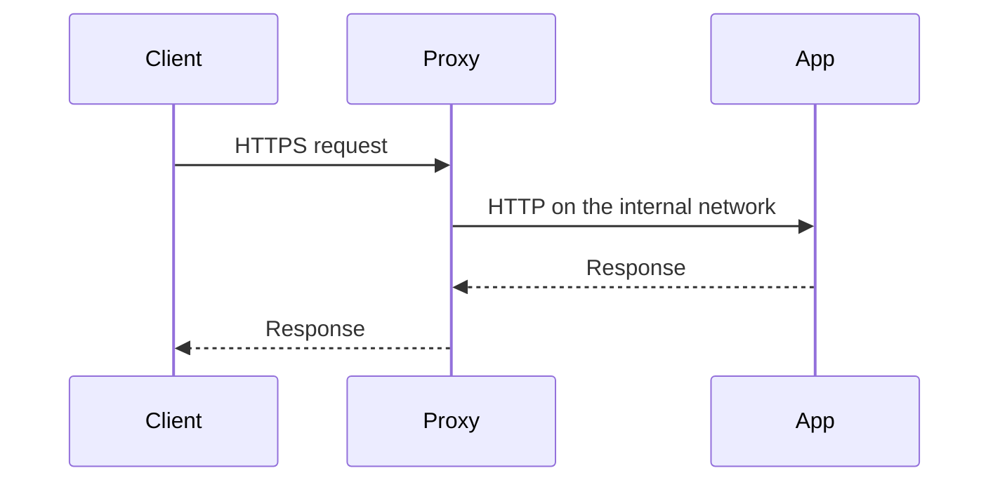

import Callout from "../../components/mdx/Callout.astro";
import Decision from "../../components/mdx/Decision.astro";

This post has `draft: true`. It shows up in `pnpm dev` and is left out of the live site and the RSS feed. Delete it once you have published a few posts of your own.

## Posts and work pages

There are two places to write.

- A **work page** (`src/content/work/`) describes one project and stays current. Update it as the project changes.
- A **post** (`src/content/writing/`) is dated and covers one thing: a migration, an outage, a tool you tried, something you learned.

Set `project` in a post's frontmatter to a work page's file name and the post is listed in that project's build log. This post is filed under the case study template, so it appears at the bottom of that page.

## Frontmatter

```yaml
title: Moving the homelab to a single reverse proxy
description: One sentence. It is shown in link previews and the RSS feed.
date: 2026-11-20
updated: 2026-12-02 # optional
tags: [homelab, networking]
project: homelab # optional, a file name from src/content/work/
draft: true # remove to publish
```

A file ending in `.md` is plain Markdown. Use `.mdx` when you want the components below.

## What you can use

Headings, lists, links, tables, images and code blocks all work as normal Markdown.

| Service | Host | Exposed |
| --- | --- | --- |
| Caddy | edge | 80, 443 |
| Grafana | apps | VPN only |

```bash
# Check which ports are listening
ss -tlnp | grep -E ':(80|443)\b'
```

A `mermaid` block becomes a diagram:



<Callout type="note" title="Callouts">
Use a callout for something the reader needs even if they skim: a prerequisite, a version this applies to, a summary.
</Callout>

<Callout type="warning" title="Warnings">
Use the warning type for anything that can lose data or lock someone out.
</Callout>

<Decision
  question="Markdown files or a CMS?"
  chose="Markdown files in the repo"
  rejected={["A hosted CMS", "A notes app with export"]}
>
Posts live next to the code, so they are versioned and reviewed the same way, and the site stays fully static.
</Decision>

## Security write-ups

Before publishing anything about a vulnerability, check that it is fixed or that the owner has agreed to disclosure, and remove real hostnames, IPs, tokens and usernames from logs and screenshots.
